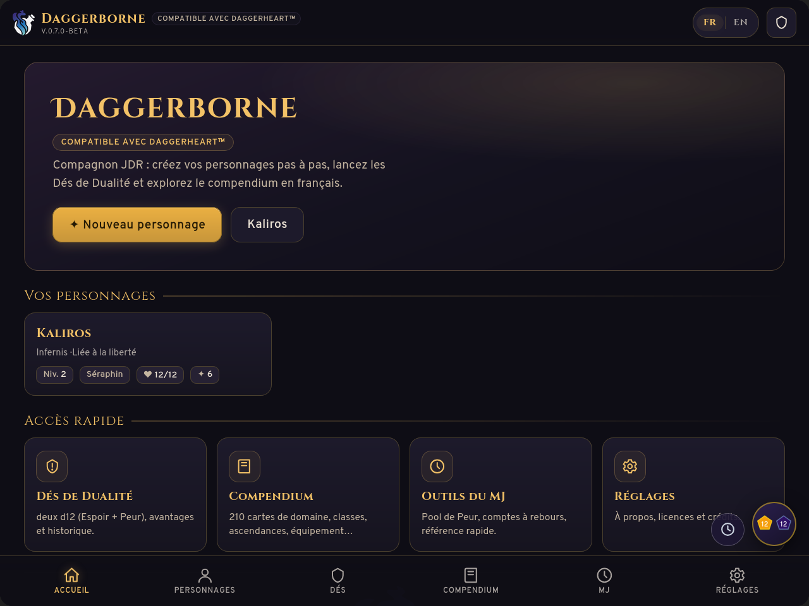
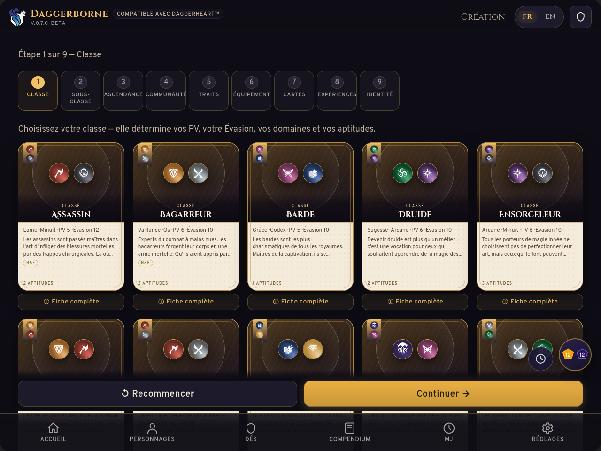
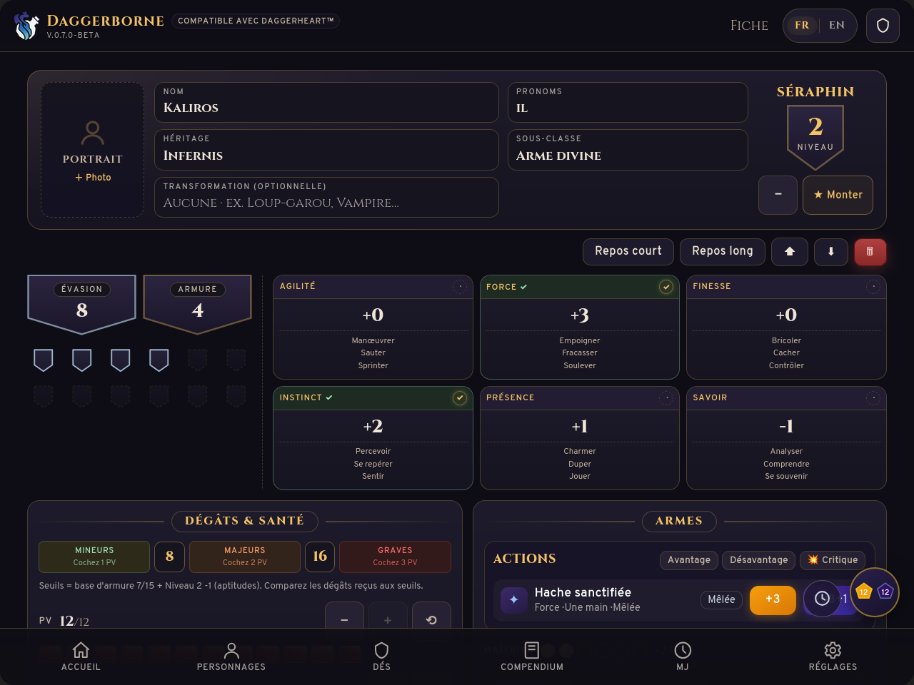

Daggerborne
Compagnon de jeu français pour Daggerheart (PWA hors-ligne)
Une application web tout-en-un pour créer vos personnages, lancer vos dés de Dualité et gérer vos parties de Daggerheart sur mobile, tablette ou ordinateur. Une fois ouverte une première fois, elle fonctionne 100 % hors-ligne et ne nécessite aucun compte.

**Aperçu**

Trois écrans de l'application en français :

| Accueil | Création de personnage | Fiche interactive |
|:---:|:---:|:---:|
|  |  |  |

Ce que fait l'application
Création & Fiche de personnage
 * Assistant en 9 étapes : laissez-vous guider de l'ascendance jusqu'aux questions de background, avec suggestions automatiques selon la classe.
 * Fiche interactive : reprenant la mise en page officielle en thème sombre. Gérez vos PV, Stress, Espoir, Or (avec conversion automatique poignées/sacs/coffres) et seuils de dégâts recalculés en temps réel.
 * Montée de niveau (Niveaux 1 à 10) : un assistant dédié en 5 étapes gère les paliers, l'achat d'améliorations, le multiclassage et l'échange de cartes de domaine selon les règles officielles.
 * Sauvegarde locale : exportez et importez vos personnages au format JSON à tout moment.
Dés de Dualité intégrés
 * Accessible directement depuis la fiche sans quitter la page.
 * Lancez vos deux d12 (Espoir et Peur) avec gestion de l'avantage/désavantage, dépense automatique d'Espoir pour vos Expériences, détection des succès critiques et historique des jets.
Compendium & Outils du MJ
 * Tout le SRD à portée de main : 210 cartes de domaine, 246 objets (butins et consommables), 13 classes, 26 sous-classes, 24 ascendances, 15 communautés, 6 transformations, 400 armes et 85 armures.
 * Bestiaire & Environnements : 264 adversaires complets et 47 environnements prêts à l'emploi, filtrables par palier et par type.
 * Écran du MJ : réserve de Peur, gestion des comptes à rebours et aide-mémoire des règles (conditions, repos, création d'affrontements).
Langues et traduction
L'interface et le cœur des règles proposent une traduction française communautaire du SRD 2.0 officiel.
 * Contenu traduit : règles de base, créateur de personnage, 210 cartes de domaine, 246 objets d'inventaire.
 * Contenu Hope & Fear : les ajouts intégrés au SRD 2.0 (domaine Effroi, 4 classes, ascendances/communautés) disposent d'une traduction communautaire signalée par un badge « H&F ».
 * Bestiaire : les statblocks des 264 adversaires et les 47 environnements sont entièrement traduits en français (descriptions, capacités, motivations et attaques).
Installation & Lancement
L'application est une PWA (Progressive Web App) purement statique.
> Important : Ne lancez pas index.html directement (en file://), cela bloquerait le mode hors-ligne. Passez toujours par un serveur local ou un hébergement web.
> 
1. Tester en local
Décompressez l'archive et lancez un serveur HTTP simple dans le dossier :
python3 -m http.server 8080

Rendez-vous ensuite sur http://localhost:8080.
2. Installer sur mobile ou ordinateur
Une fois l'application hébergée (GitHub Pages, Netlify, Vercel...) et ouverte dans votre navigateur :
 * iOS (Safari) : appuyez sur Partager → Sur l'écran d'accueil.
 * Android (Chrome) : ouvrez le menu ⋮ → Installer l'application.
 * PC / Mac (Chrome, Edge) : cliquez sur l'icône d'installation à droite de la barre d'adresse.
Vie privée
Aucune donnée ne quitte votre appareil. Vos personnages, vos jets de dés et vos réglages MJ sont enregistrés uniquement dans le stockage local (localStorage) de votre navigateur.
Notes techniques & Contribution
Les données du jeu sont déjà compilées dans `data/` à partir du SRD 2.0 officiel et des traductions communautaires (voir les licences ci-dessous). Les scripts de génération ne sont pas inclus dans ce dépôt public : pour mettre à jour les données, repartez des sources SRD/DRS et régénérez les fichiers JSON.

Licences & Crédits
 * Règles et contenu : This product includes materials from the Daggerheart System Reference Document 2.0, © 2026 Critical Role, LLC. under the terms of the Darrington Press Community Gaming (DPCGL) License — <https://www.daggerheart.com> · <https://darringtonpress.com/license/>.
 * Icônes de domaines : icônes vectorielles originales (SVG) créées spécifiquement pour Daggerborne (sous licence MIT).
 * Traductions du bestiaire et des environnements : module communautaire **Daggerheart DRS - Français (non officiel)** de Sasmira, sous GNU AGPL-3.0 — <https://gitlab.com/sasmira/daggerheart-fr-foundryborne>. Le code et les données adaptées sont distribués conformément aux termes MIT et GNU AGPL-3.0 détaillés dans `LICENSE`.
 * Architecture & Design : inspirés du module Foundryborne Daggerheart (© Foundryborne contributors, licence MIT).
Application non officielle et gratuite développée par des fans, sans affiliation avec Critical Role, Darrington Press, Black Book Éditions ni Foundry Gaming LLC.
